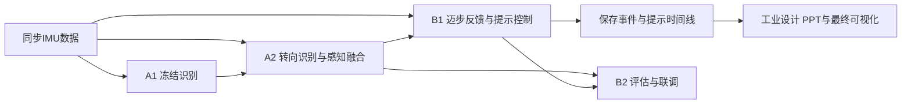

# FoGGuard

FoGGuard 是 ME5412 课程项目，研究如何利用可穿戴 IMU 识别冻结步态与转向，并根据提示后的运动反馈，控制脚印和声音提示。

系统目标是：检测到持续冻结后，给出与方向一致的迈步提示；在有效观察中持续没有迈步响应时，切换原地交替踱步；获得可靠响应后重新引导向前，满足退出条件后停止提示。

## 项目入口

| 内容 | 文档 |
|---|---|
| 项目目标、系统设定与交付范围 | [项目说明](docs/PROJECT_OVERVIEW.md) |
| A1 / A2 / B1 / B2 与工业设计的职责 | [分工与交付顺序](docs/ROLES_AND_ROADMAP.md) |
| 模块关系、状态和验收要求 | [系统架构](docs/ARCHITECTURE.md) |
| 当前完成状态 | [项目状态](docs/PROJECT_STATUS.json) |
| A 组统一图表与数据展示（英文） | **[打开统一页面](docs/a_group_showcase/index.html)** · [图表及数据索引](docs/a_group_showcase/FIGURE_CATALOG.csv) |
| A 组测试来源与算法复现 | [固定测试报告](docs/a_group/README.md) · [感知接入](docs/a2/fusion/README.md) |
| 预训练模型下载（A1 三模型＋A2 当前方向） | **[下载模型 ZIP](https://github.com/JYAXR/ME5412-FoGGuard/releases/download/a-group-models-2026-10-30/FoGGuard-A-Group-Models-20261030.zip)** · [安装与运行](docs/MODEL_DOWNLOADS.md)，无需重新训练 |
| 环境、模型推理与工程演示 | [快速开始](docs/QUICKSTART.md) |
| 字段、单位和时序约定 | [接口约定](docs/INTERFACE_CONTRACT.md) · [数据格式](docs/DATA_SCHEMA.md) |

## 系统与分工



A 组负责感知，B 组负责反馈、决策和验证。最终可视化读取保存的模块输出，模型和控制规则由算法层执行。

## 已有成果：A 组感知与图表数据已交付

**[Unified English charts and data](docs/a_group_showcase/index.html)**：流程与方法、数据范围、冻结、方向、融合影响和联合时间线集中展示；每图有简短说明及 PNG/SVG/CSV。正式测试为主线，开发验证集中在页面附录，用于解释方案选择。

提供三种可运行的冻结 / 非冻结模型、统一推理入口、训练配置、效果对比和交接包。下表使用冻结权重和阈值后的独立 TEST：4 人、16 条记录、1605 个共同窗口，其中 253 个冻结窗口。

| 方法 | 输入与表征 | Precision | Recall | FoG F1 |
|---|---|---:|---:|---:|
| 左踝历史特征 RF | 左踝加速度和角速度，140 维时序特征 | 0.346 | 0.806 | 0.485 |
| 双踝 RF | 左右踝角速度，66 维特征 | 0.413 | 0.838 | 0.554 |
| 左踝 CNN | 左踝三轴角速度，两秒波形 | 0.535 | 0.581 | 0.557 |

模型由运行参数显式选择，融合参考仍为测试前确定的 `bilateral_rf`。冻结误报与漏检仍较明显。当前方向模型在 676 个有效且目标明确的测试窗口上准确率为 81.07%、macro-F1 为 0.844；固定门控和平滑后的准确率为 51.78%、覆盖率为 54.73%，需单独报告。[固定测试报告](docs/a_group/README.md) 给出基线、完整分母和限制。模型实现见 [A1 方法](docs/a1/SELECTED_METHODS.md)。

## 当前进度与后续交付

A1/A2 的算法、固定独立测试和统一图表已合并到 `main`。A 组进入接口维护与交接支持阶段；后续主线为 B1 的运动反馈及提示控制、B2 的联合验证和展示包。工业设计可立即使用现有英文图表制作 PPT，并行准备最终回放界面。

| 成员 | 当前已具备 | 后续任务与交付 |
|---|---|---|
| A1 | 三种冻结模型、独立测试及图表已交付 | [维护模型包及输入约定，支持下游复现](docs/tasks/A1.md) |
| A2 | 当前方向、感知融合、独立测试及统一展示已交付 | [维护感知接口与字段说明，支持下游读取](docs/tasks/A2.md) |
| B1 | 脚印/声音、模拟响应、踱步和退出状态机基础 | [实现真实 IMU 运动代理、有效无响应计时、反馈适配及提示切换](docs/tasks/B1.md) |
| B2 | 指标审计、工程场景及策略对照工具；可直接消费感知时间线 | [核对接入、联合验证、同输入策略对照和最终展示数据包](docs/tasks/B2.md) |
| 工业设计 | 7 张英文图表、9 张数据表、简单说明及回放页面基础 | [制作 PPT、接入最终命令回放、完成可视化与演示视频](docs/tasks/DESIGN.md) |

执行顺序与里程碑见 [分工与交付顺序](docs/ROLES_AND_ROADMAP.md)。冻结误报、方向融合覆盖损失和提前预测不可用属于已记录的能力边界；本轮交付不安排 A 组继续训练或重新选择测试阈值。

## 最小运行

Python 3.12，在仓库根目录：

```bash
python -m pip install -r requirements.txt
python -m pip install -e .
python -X utf8 scripts/run_complete_demo.py --output-dir reports/project_demo_NEW
```

打开生成的 `index.html` 查看脚印、声音状态和控制过程。该命令使用构造候选与模拟响应，验证工程行为。真实感知输出使用 [A1 模型接入](docs/A1_A2_START_HERE.md) 和 [A1+A2 感知入口](docs/a2/fusion/README.md)。B1/B2 在这些输出上继续开发。

## 证据与范围

FoG-STAR 用于真实冻结识别与转向任务；运动响应代理、预设模拟响应和真实位置反馈分别记录来源。公开数据没有独立逐步前进位移真值，运动代理只能支持相应的动作判断。工程演示展示切换过程，不能作为患者恢复效果。

原始数据、模型权重及生成目录不提交 Git。共享类型的变更按 [协作规则](docs/COLLABORATION.md) 评审。A 组交付完成；真实反馈、闭环提示、四模块联合验收和最终可视化仍按后续任务推进。
