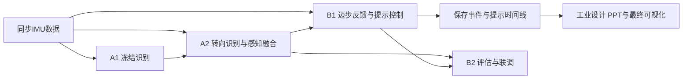

# FoGGuard

FoGGuard 是 ME5412 课程项目，研究如何利用可穿戴 IMU 识别冻结步态与转向，并根据提示后的运动反馈，控制脚印和声音提示。

系统目标是：检测到持续冻结后，给出与方向一致的迈步提示；在有效观察中持续没有迈步响应时，切换原地交替踱步；获得可靠响应后重新引导向前，满足退出条件后停止提示。

## 项目入口

| 内容 | 文档 |
|---|---|
| 项目目标、系统设定与交付范围 | [项目说明](docs/PROJECT_OVERVIEW.md) |
| A1 / A2 / B1 / B2 与工业设计的职责 | [分工与交付顺序](docs/ROLES_AND_ROADMAP.md) |
| 模块关系、状态和验收要求 | [系统架构](docs/ARCHITECTURE.md) |
| 当前完成状态 | [项目状态](docs/PROJECT_STATUS.json) |
| A2 展示图表、准确率数据与图注 | [A2 展示结果包](docs/a2/presentation/README.md) |
| A2 已训练的当前方向模型下载与运行 | [A2 当前方向模型](models/a2/current/README.md) |
| 环境、模型推理与工程演示 | [快速开始](docs/QUICKSTART.md) |
| 字段、单位和时序约定 | [接口约定](docs/INTERFACE_CONTRACT.md) · [数据格式](docs/DATA_SCHEMA.md) |

## 系统与分工



A 组负责感知，B 组负责反馈、决策和验证。最终可视化读取保存的模块输出，模型和控制规则由算法层执行。

## A1：已完成冻结识别交付

**[English presentation figures and data](docs/a1/figures/README.md)**：四张英文 PNG/SVG 图、英文图注、汇总 CSV 和字段说明，可直接用于课程汇报。

提供三种可运行的冻结 / 非冻结模型、统一推理入口、训练配置、效果对比和交接包。对比使用 FoG-STAR 的同一组开发验证数据：4 人、20 条记录、2014 个窗口，其中 470 个冻结窗口。

| 方法 | 输入与表征 | Precision | Recall | FoG F1 |
|---|---|---:|---:|---:|
| 左踝历史特征 RF | 左踝加速度和角速度，140 维时序特征 | 0.562 | 0.898 | 0.691 |
| 双踝 RF | 左右踝角速度，66 维特征 | 0.572 | 0.857 | 0.686 |
| 左踝 CNN | 左踝三轴角速度，两秒波形 | 0.672 | 0.683 | 0.677 |

模型由运行参数显式选择，A2 接入参考使用 `bilateral_rf`。三者输入和模型选择流程不同，以上是开发验证结果；独立最终评价与系统联调另行验收。完整实现、误报时间及边界见 [A1 方法与效果](docs/a1/SELECTED_METHODS.md)。

## 后续交付

| 成员 | 当前基础 | 要完成的交付 |
|---|---|---|
| A1 | 三种冻结模型和评估已交付 | 维护模型包与接口，支持 A2 接入 |
| A2 | [方向模型已开发验证；提前预测未达到可用水平](docs/a2/RESULTS.md) | [独立验收、A1 融合时间线](docs/tasks/A2.md) |
| B1 | 有脚印声音控制、模拟响应与踱步状态机 | [真实信号运动代理、响应判据、提示切换与控制验证](docs/tasks/B1.md) |
| B2 | 有指标审计、工程场景和策略对照工具 | [四模块联调、统一验收、对比报告和展示数据包](docs/tasks/B2.md) |
| 工业设计 | 有保存时间线的回放页面 | [PPT、最终可视化与演示视频](docs/tasks/DESIGN.md) |

## 最小运行

Python 3.12，在仓库根目录：

```bash
python -m pip install -r requirements.txt
python -m pip install -e .
python -X utf8 scripts/run_complete_demo.py --output-dir reports/project_demo_NEW
```

打开生成的 `index.html` 查看脚印、声音状态和控制过程。该命令使用构造候选与模拟响应，验证工程行为。真实 A1 模型的运行方法见 [A1 接入](docs/A1_A2_START_HERE.md)。

## 证据与范围

FoG-STAR 用于真实冻结识别与转向任务；运动响应代理、预设模拟响应和真实位置反馈分别记录来源。公开数据没有独立逐步前进位移真值，运动代理只能支持相应的动作判断。工程演示展示切换过程，不能作为患者恢复效果。

原始数据和生成目录不提交 Git。用户明确批准发布的 A2 当前方向模型见 `models/a2/current/`；其余权重通过交接包单独分发。共享类型的变更按 [协作规则](docs/COLLABORATION.md) 评审；各模块的新适配器完成接线前，现有演示不代表四个正式算法已经全部集成。
