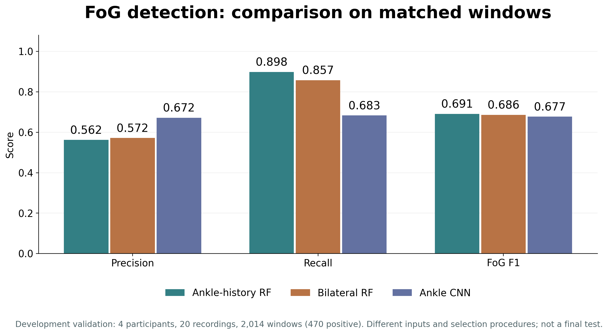
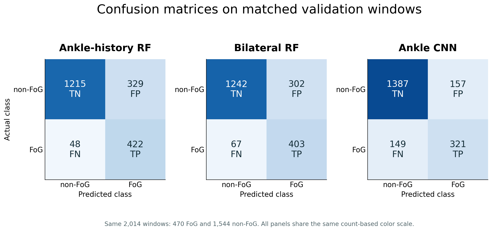
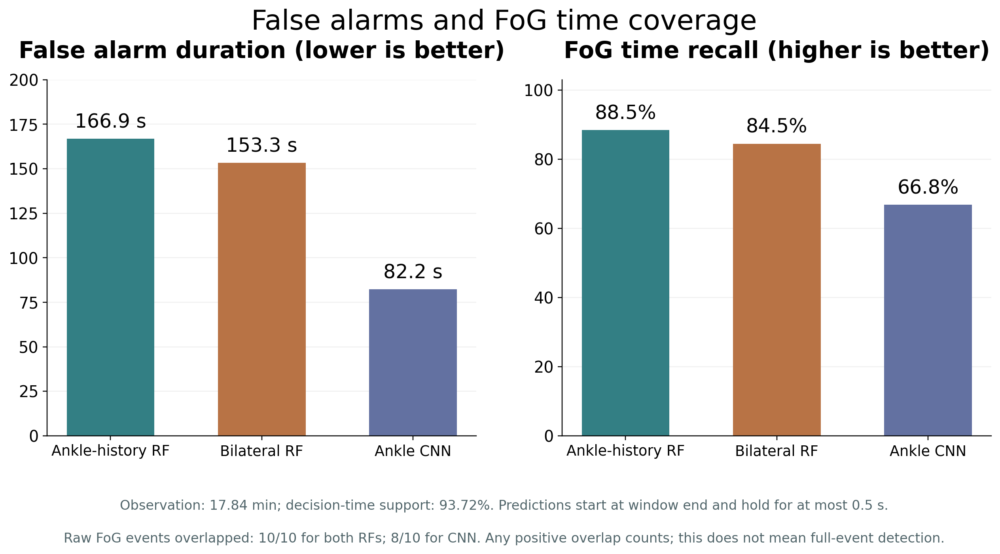
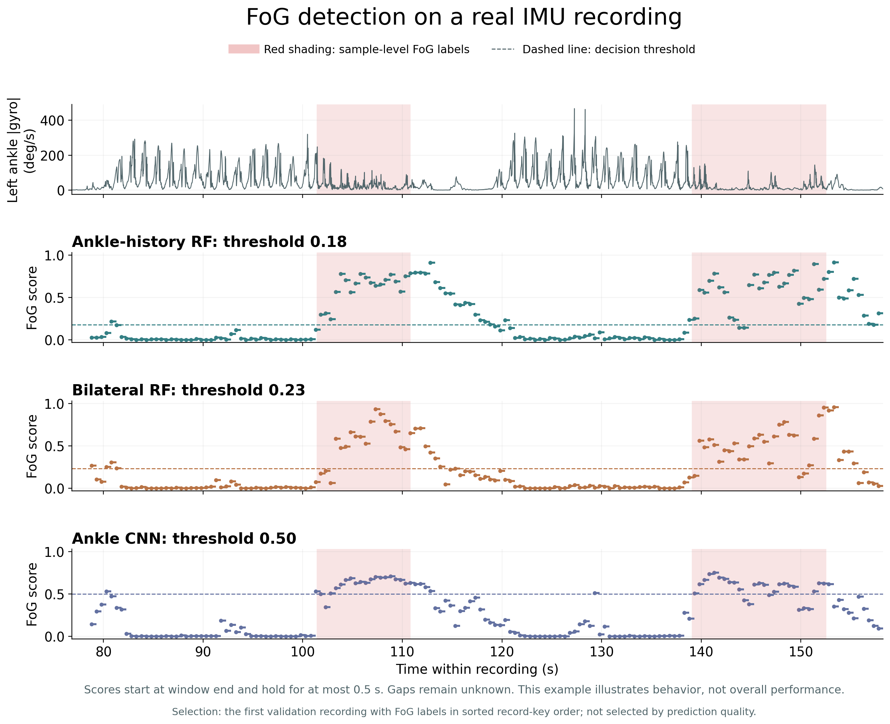

# A1 presentation figures and data

Four figures in PNG and SVG, aggregate CSV data, English slide captions and a data dictionary.

The results describe FoG-STAR development validation: **4 participants, 20 recordings, 2,014 matched windows, 470 positive windows and 10 raw FoG events**. Inputs and selection procedures differ between models. Independent final evaluation remains pending.

## Methods

- **Ankle-history RF** (`ankle_history_rf`): left-ankle acceleration and gyroscope, 66 current features plus past-window summaries and availability flags, 140 features total. Random forest with 300 trees. TRAIN14 fitting and VALIDATION4 F1 threshold selection (0.18).
- **Bilateral RF** (`bilateral_rf`): gyroscope xyz from both ankles, 66 features from a completed two-second window. Random forest with 300 trees. Threshold 0.23 selected by participant-grouped OOF within TRAIN14, followed by final TRAIN fitting.
- **Ankle CNN** (`ankle_cnn`): mean-centered left-ankle gyroscope waveforms, four causal convolution layers and Dense48, 8,353 parameters. Validation early stopping and threshold 0.50. Architecture adapted from the public author implementation, without a claim of an original CNN architecture or strict numerical reproduction.

All methods use 60 Hz signals and a 120-sample window, updated every 30 samples. Scores become available at window end. They are not clinically calibrated risk probabilities.

| Method | Precision | Recall | FoG F1 | False alarm duration |
|---|---:|---:|---:|---:|
| Ankle-history RF | 0.562 | 0.898 | 0.691 | 166.9 s |
| Bilateral RF | 0.572 | 0.857 | 0.686 | 153.3 s |
| Ankle CNN | 0.672 | 0.683 | 0.677 | 82.2 s |

## 1. Matched-window model comparison

**Slide caption:** On 2,014 matched validation windows, the ankle-history RF achieves the highest FoG F1 and recall. The CNN achieves higher precision with lower recall. These are comparisons of complete trained configurations, including different sensors and selection procedures.

[Scalable SVG](01_model_comparison.svg)

## 2. Confusion matrices

**Slide caption:** Both RF models miss fewer FoG windows but produce more false alarms. The bilateral RF has TP=403, FP=302, FN=67 and TN=1,242. The CNN reduces false positives to 157 while increasing false negatives to 149. Non-FoG includes all labeled non-freezing observations and should not be described as healthy gait.

[Scalable SVG](02_confusion_matrices.svg)

## 3. False alarms and FoG time coverage

**Slide caption:** Over the same 17.84-minute observation period, the CNN reduces false alarm duration to 82.2 s, while FoG time recall decreases to 66.8%. The ankle-history RF and bilateral RF cover 88.5% and 84.5% of labeled FoG time. Supported decision time is 93.72% for all three methods.

[Scalable SVG](03_alarm_coverage_tradeoff.svg)

## 4. Real-signal inference timeline

**Slide caption:** Left-ankle gyroscope magnitude, sample-level FoG labels and three model scores are aligned on the same recording. Dashed lines show thresholds. Each score becomes available at the input-window end and is held for at most 0.5 s. The example preserves false alarms and delayed score changes.

Selection follows a fixed rule: the first validation recording with positive raw FoG labels in sorted record-key order. It is not selected by prediction quality. Window labels require at least 50% FoG samples, whereas red shading shows sample-level labels; temporal boundaries therefore need not coincide.

[Scalable SVG](04_real_signal_timeline.svg)

## Recommended use

Use Figures 1, 3 and 4 in the main presentation. Keep Figure 2 for explaining error counts or answering questions. PNG files can be inserted directly into PowerPoint; SVG files retain vector scaling. English captions can be copied into slides or speaker notes.

[Aggregate data](model_comparison.csv) | [Data dictionary](DATA_DICTIONARY.md) | [File hashes and provenance](MANIFEST.json)

The figures report binary FoG detection. They do not establish early FoG forecasting, turning recognition, step-success classification or clinical efficacy. Missing prediction support remains unknown. Raw patient CSVs, per-window patient outputs and model weights are not included.

## Sources

FoG-STAR dataset, Zenodo DOI [10.5281/zenodo.17838806](https://doi.org/10.5281/zenodo.17838806), CC BY 4.0. Figures prepared for the FoGGuard course project.

CNN architecture reference: [public author implementation](https://github.com/Lu1g1n0/FoG-detection-using-a-single-ankle-mounted-sensor), DOI [10.1177/1877718X241302766](https://doi.org/10.1177/1877718X241302766).
