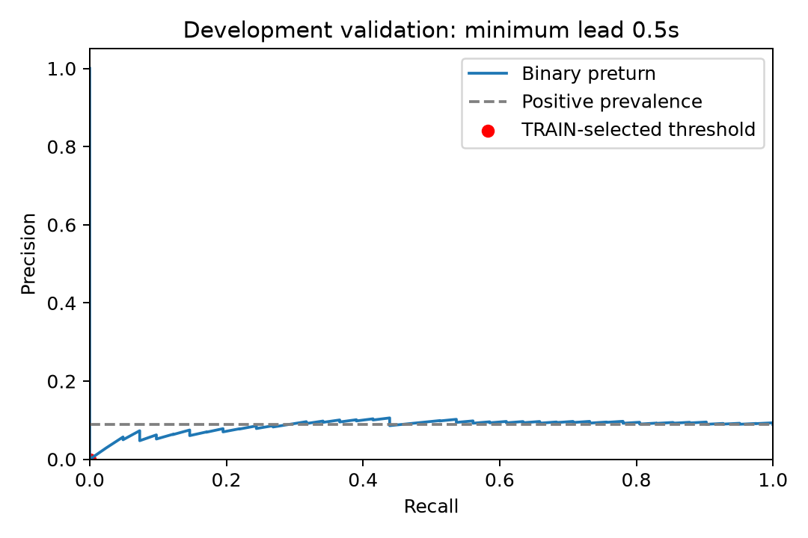
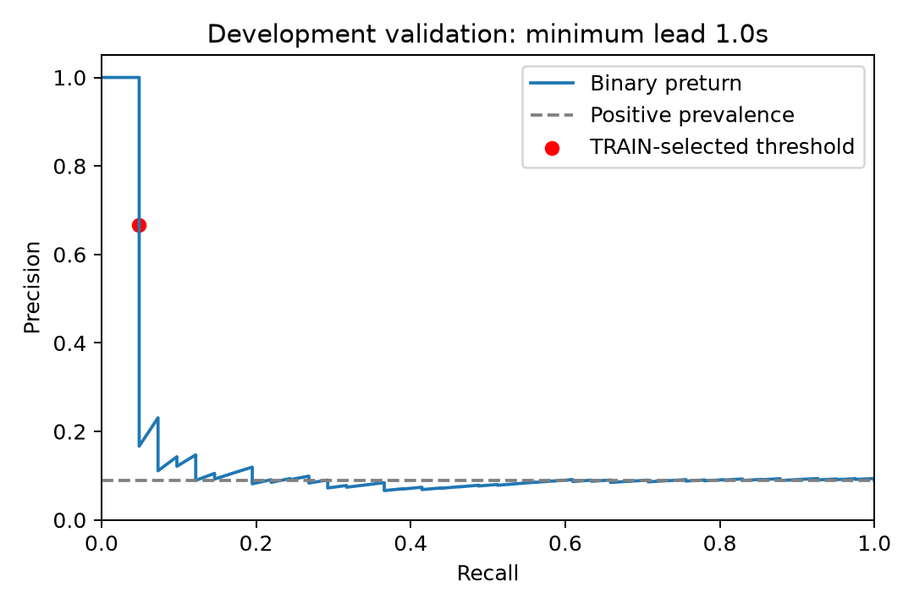

# 提前转向二分类与短时特征结果

当前结论：已完成二分类、短时准备动作特征、双踝不对称和两阶段预测的实现及评价，
仍未获得可用于决策的跨人提前预测。当前方向识别模型保持原结果。

## 方法和评价约束

数据、记录网格与转向目标沿用 [A2 方法说明](README.md)：120 点历史，60 Hz，
每 30 点做一次判断；预测输入末点后 `[h, h+0.5)` 秒内的 Walk→Turn 起点，
h 为 0.5 秒或 1.0 秒。未来标签仅生成训练和评价目标。

三种特征与两种分类器组合，共比较六个候选：

| 特征方案 | 维数 | 内容 |
|---|---:|---|
| 左踝＋背部原长窗 | 216 | 原有两秒统计及频域特征 |
| 左踝＋背部短时变化 | 248 | 最后 0.25/0.5/1/2 秒统计、斜率及相对前段变化 |
| 双踝＋背部短时变化 | 420 | 上述短时特征，加入双踝能量、旋转与相关性差异 |

短时特征使用重力方向角速度、角速度模长、去重力加速度模长及加速度模长。
两种分类器为标准化后的平衡逻辑回归（C=0.1）和 200 棵树的平衡随机森林（最小叶子 5）。
第一阶段预测是否即将转向；第二阶段只用训练集中真实转向正例学习左右方向。
运行阶段不读取活动或冻结标签，缺测/断档保持 unknown。

使用固定 14 人 TRAIN，在 A1 配置的三个参与者隔离折上生成 OOF。
所有候选都用三处传感器完整的相同行训练、选择与比较，避免数据支持范围不同导致虚假提升。
以 OOF 二分类 F1 选模型与阈值，同时要求完整流误报不超过 1 次/分钟、
负类报警窗口占比不超过 10%。阈值网格事先写入配置，不在验证集上挑阈值。

开发验证仍为 1/5/10/12 四人。该验证集此前已经检查过，不是盲测；
TEST 7/11/21/22 未提取特征或评分。每个提前量的有效明确目标仍为
462 个窗口，其中真实转向 41、无转向 421。

## 训练人员内的结果

| RF 特征方案 | 0.5 秒提前量 OOF 召回率 | 1.0 秒提前量 OOF 召回率 |
|---|---:|---:|
| 左踝＋背部原长窗 | 7.09% | 3.17% |
| 左踝＋背部短时变化 | 3.94% | 7.94% |
| 双踝＋背部短时变化 | 1.57% | 7.94% |

以上是各方案满足误报约束的 OOF 阈值下的召回率，目标为是否转向，与左右分类成绩分开。
逻辑回归在预设阈值网格内没有满足上述完整流误报约束的工作点。
最终 0.5 秒选择原长窗 RF（阈值 0.25），1.0 秒选择双踝短时 RF（阈值 0.30）。

## 固定开发验证结果

| 指标 | 至少提前 0.5 秒 | 至少提前 1.0 秒 |
|---|---:|---:|
| 二分类准确率 | 91.13% | 91.34% |
| 始终预测无转向的准确率 | 91.13% | 91.13% |
| 转向精确率 | 0.00% | 66.67%（2/3） |
| 转向召回率 | 0.00%（0/41） | 4.88%（2/41） |
| 转向 F1 | 0.00% | 9.09% |
| AUROC | 0.517 | 0.490 |
| Average precision | 0.089 | 0.140 |
| 真实转向比例 | 0.089 | 0.089 |
| 完整流误报次数/分钟 | 0.000 | 0.131 |
| 同时预测正确转向及左右的事件数 | 0/41 | 0/41 |

0.5 秒模型没有触发警报；1 秒模型只有 3 个明确目标窗口触发，2 个是真转向，
但这两次的左右方向都不正确。因此 66.67% 的精确率只基于 3 个触发样本，
不能抵消极低的召回率。两个模型均未达到“检出至少一半事件且满足误报约束”的研究目标。

完整流误报还包含非直行/混合历史上的错误触发，不只计算 421 个无转向窗口。
0.5 秒负类有效观察为 15.367 分钟，1 秒为 15.217 分钟；相距不超过 0.75 秒的
错误报警合为一个事件。同时报告报警窗口占比，避免长时间持续错误报警只算一次的问题。





## 是否仅仅阈值过保守

对固定模型的验证分数做了诊断性扫描，没有据此修改发布模型或阈值。
预设网格中能达到至少 50% 召回率且误报最少的诊断点是：

| 提前量 | 阈值 | 召回率 | 精确率 | 完整流误报/分钟 | 负类报警窗口占比 |
|---|---:|---:|---:|---:|---:|
| 0.5 秒 | 0.075 | 63.41% | 9.35% | 7.94 | 17.46% |
| 1.0 秒 | 0.050 | 78.05% | 8.89% | 8.28 | 24.42% |

降低阈值确实能触发更多转向，但大约每分钟误报 8 次，精确率接近数据的真实转向比例。
这说明当前限制不只是触发阈值，模型排序也没有形成稳定有效的区分。
本轮不支持把提前预测接入正式提示决策，也不能据此证明所有其他方法都不可行。

## 复现与证据

```bash
python -X utf8 scripts/train_a2_preturn_binary.py --output reports/a2_binary_NEW
python -X utf8 -m scripts.audit_a2_preturn_binary --run reports/a2_binary_NEW --output reports/a2_binary_audit_NEW
python -X utf8 scripts/predict_a2_preturn_binary.py --model reports/a2_binary_NEW/preturn_1.0s/model.joblib --input INPUT.csv --output reports/a2_binary_runtime_NEW.csv
```

配置为 `config/a2_preturn_binary.json`，实现为 `src/fogguard/turning/preturn_binary.py`。
本地模型、OOF、运行输出及独立真值保存在 `reports/a2_binary_20261030_01/`，
阈值诊断在 `reports/a2_binary_threshold_audit_20261030_01/`。
离线 `available_at_s` 为输入末点，实时使用须加入实际计算延迟。

汇总可核查证据：[模型与全部候选结果](binary_results.json) · [阈值诊断](binary_threshold_audit.json)。
原始数据、权重和逐窗文件不提交 Git。没有使用 TEST 进行选择或评分。

交付检查：283 项测试通过、7 项可选依赖测试跳过，Ruff 通过；工程对照 560 次运行、
884 份 CSV 哈希验证通过，关键审计失败为 0。未提供 OOF 冻结模型审计输入的
兼容真实数据检查保持 NOT_RUN，不以工程检查替代本页的提前预测实验。
