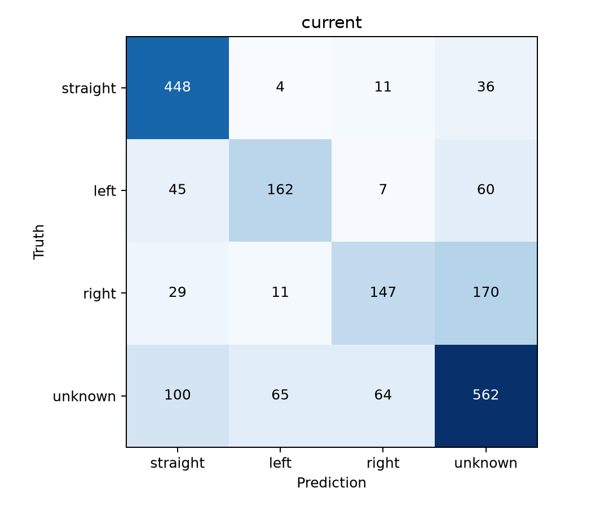
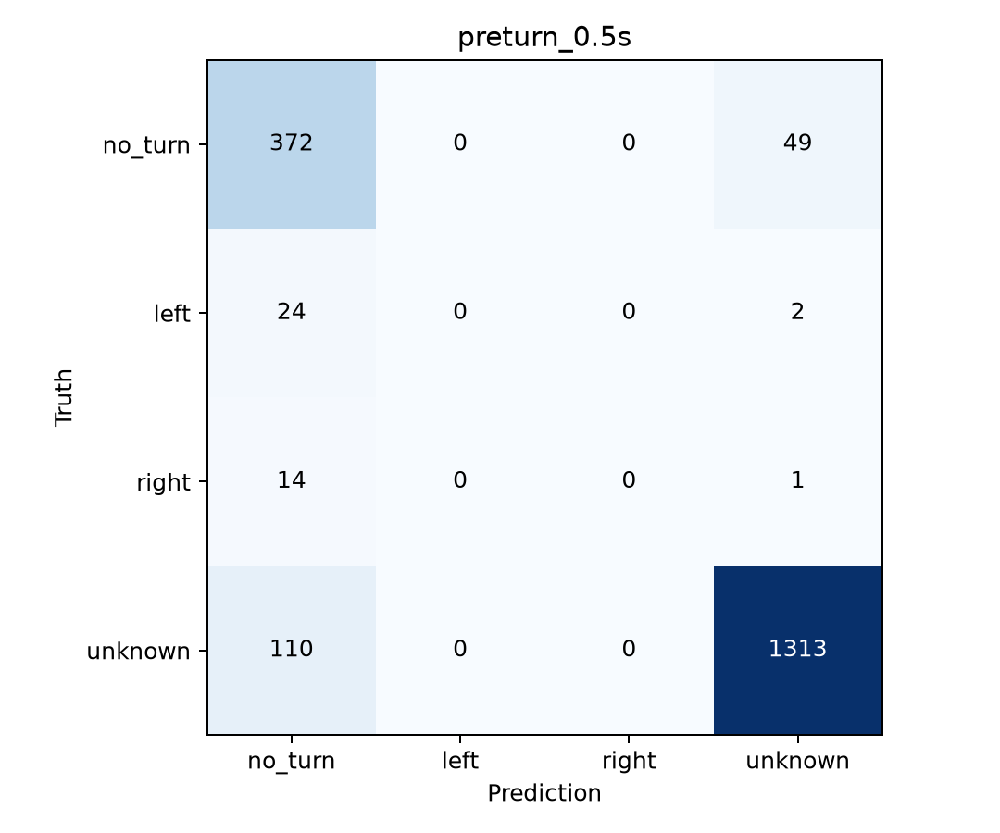
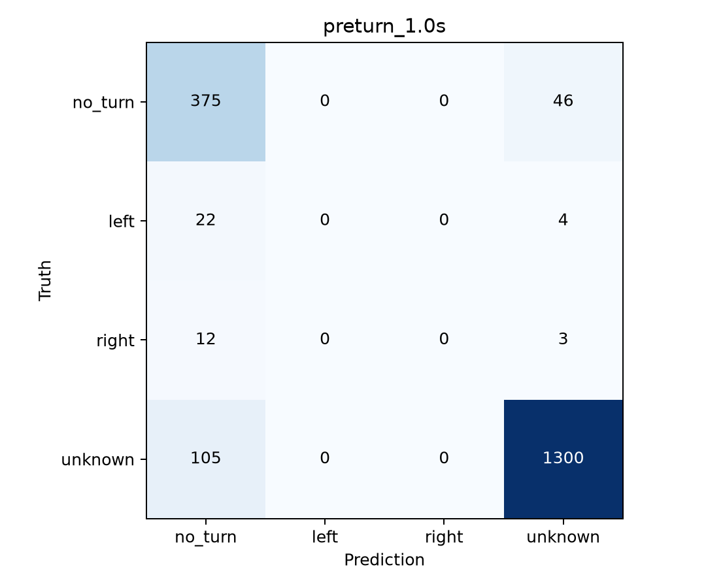

# A2 实现与真实数据结果

日期：2026-10-30。两项算法的实现与开发验证已完成；提前转向预测未达到可用水平。
A1 融合和 B1/B2 联调尚待完成。本页的准确率均为实际运行结果。

当前方向识别作为主要成果；提前预测保留为有完整实验支撑的可行性研究。
汇报图表、数据和中文图注见 [展示结果包](presentation/README.md)。

二分类、短时变化与双踝特征的进一步结果见 [提前转向研究](PRETURN_BINARY.md)，
固定验证转向召回仍仅为 0% / 4.88%，尚无有效提前方向预测。

## 数据与评价范围

FoG-STAR v3，原始数据 SHA-256 与 A1 固定配置一致。
TRAIN 为 2/3/4/6/8/9/13/14/15/16/17/18/19/20；开发验证为 1/5/10/12。
TEST 7/11/21/22 未提取特征、未评分。模型与拒识阈值用开发验证选择，
下列成绩不能作为独立盲测结果。窗口之间有重叠，不能把它们当作独立受试者。

完整配置、哈希、人员结果、候选模型对照及混淆矩阵数值见 [results.json](results.json)。
复现方法、时间边界和目标定义见 [实现说明](README.md)。

## 当前方向识别

最终使用 12 维重力投影角速度特征及 300 棵树随机森林。
背部和左踝分别提供整窗角速度均值/标准差、四个半秒段均值。
类别为 straight / left / right / unknown。两秒输入每 0.5 秒更新，unknown 也作为训练类别。

| 方法 | 明确方向准确率 | 三类 macro-F1 |
|---|---:|---:|
| 重力投影角速度阈值基线 | 66.55% | 66.01% |
| 完整 216 维特征 RF | 53.36% | 59.56% |
| 重力投影 12 维特征 RF，最终方案 | **66.99%** | **71.97%** |

主评价共有 1130 个有效且方向明确的窗口，757 个正确。拒识算错误，未从主准确率中排除。
其余数据的范围：2070 个完整网格窗口中，149 个因缺测/不连续无效；1921 个有效窗口中，
791 个为 unknown 真值。包含 unknown 的完整四类准确率为 68.66%，macro-F1 为 65.58%。

| 真实方向 | 窗口数 | 召回率 |
|---|---:|---:|
| 直走 | 499 | 89.78% |
| 左转 | 274 | 59.12% |
| 右转 | 357 | 41.18% |

明确方向窗口的预测覆盖率为 76.46%；只对未拒识窗口计算的准确率为 87.62%。
87.62% 是选择性准确率，不能替代主准确率 66.99%。
逐人主准确率为：1 号 47.48%，5 号 74.24%，10 号 74.84%，12 号 90.15%。
跨人差异明显，右转漏检与拒识较多，当前仍属可复现的开发基线。

## 转向前方向预测

训练两个独立的随机森林模型，最终均选择完整 216 维特征。
输入全部早于目标转向起点：最小提前量 h 分别为 0.5 秒、1.0 秒，
目标区间为输入末点后的 `[h, h+0.5)` 秒。负例保留真实网格分布，非全直行历史学习 unknown。
模型不读取活动标签；未来标签仅用于定义离线目标。

| 任务 | 明确目标准确率 | 三类 macro-F1 | 左转召回 | 右转召回 |
|---|---:|---:|---:|---:|
| 至少提前 0.5 秒 | 80.52%（372/462） | 29.84% | 0.00% | 0.00% |
| 至少提前 1.0 秒 | 81.17%（375/462） | 30.12% | 0.00% | 0.00% |
| 始终预测 no_turn 的基线 | **91.13%（421/462）** | — | 0.00% | 0.00% |

每项任务都有 421 个 no_turn、26 个 left、15 个 right 的有效明确目标。
TRAIN 的转向正例仅约 130 个，验证中的真实提前方向没有被正确识别。
同样比较过重力投影特征，左右召回也为 0；完整候选结果均保留。

验证集共 45 个 Walk→Turn 标注起点，两种提前量各有 41 个可评价、4 个无合格输入。
两个最终模型都漏掉全部 41 个可评价事件；误报为 0 次/分钟，是因为没有发出转向警报，
不能视为良好检测性能。不能根据本次单一模型族失败断言所有提前预测方法都不可行。

结论：预测代码和实验已完成，但当前模型未学到可跨人验证的提前转向能力。
约 81% 的表面准确率来自多数 no_turn 类，不支持接入正式提示决策。
后续改进需针对少数正例和准备动作特征开展新的 TRAIN 内人员分组实验，再进行独立验证。

## 交付与检查

- 源码：`src/fogguard/turning/learned.py`。
- 入口：`scripts/train_a2_turning.py`、`scripts/predict_a2_turning.py`。
- 配置：`config/a2_turning.json`；依赖：`requirements-a2.txt`。
- 本地正式运行目录：`reports/a2_final_20261030/`，包含三个模型、无标签运行输出、
  独立真值、指标、事件可用性审计、失败样例与配置/来源哈希。
- 原始数据和逐窗运行文件保存在忽略目录。用户明确批准发布的当前方向权重见 [模型交接目录](../../models/a2/current/README.md)；其余实验权重仍保存在本地。
- 11 项 A2 专项测试通过；原有工程验收 560 次策略运行、884 份 CSV 哈希检查通过。
  这些工程检查不表示 A2 已与 A1/B1/B2 完成正式联调。
