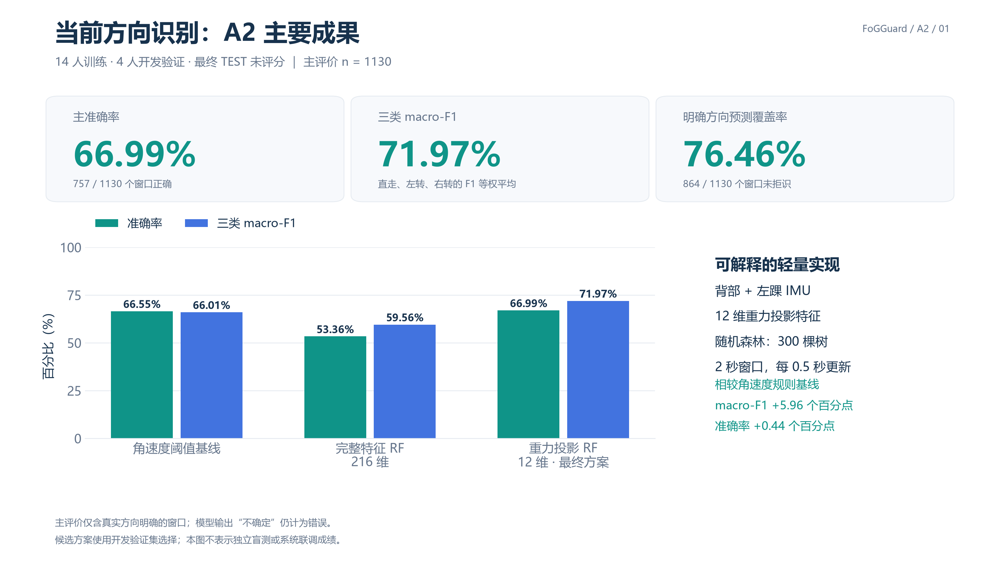
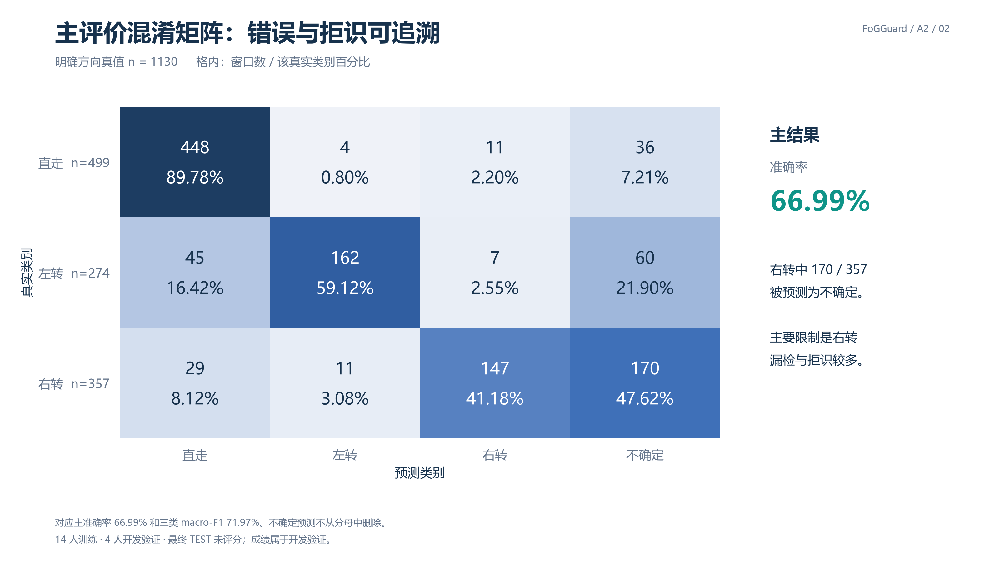
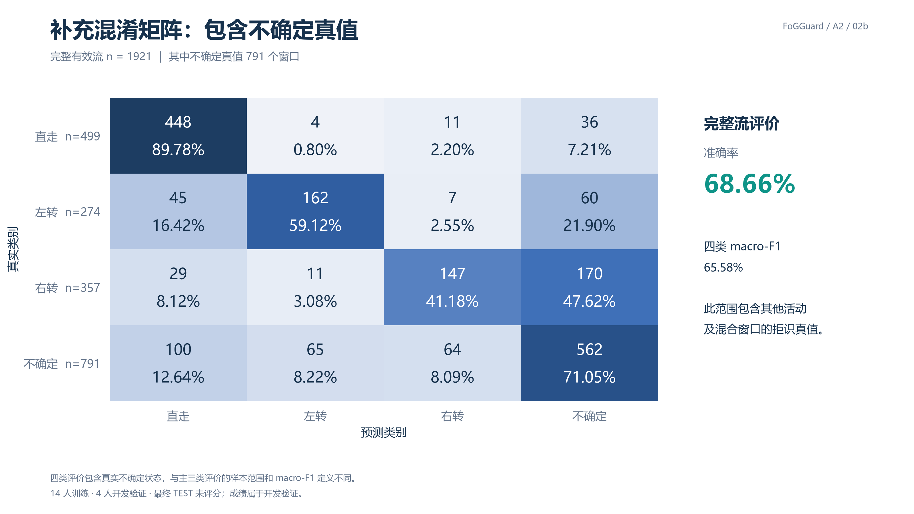
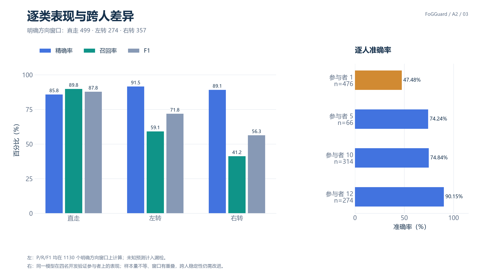
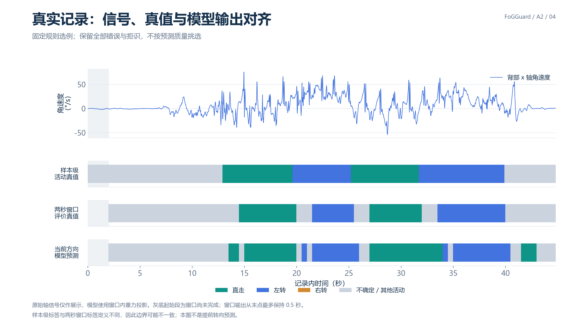
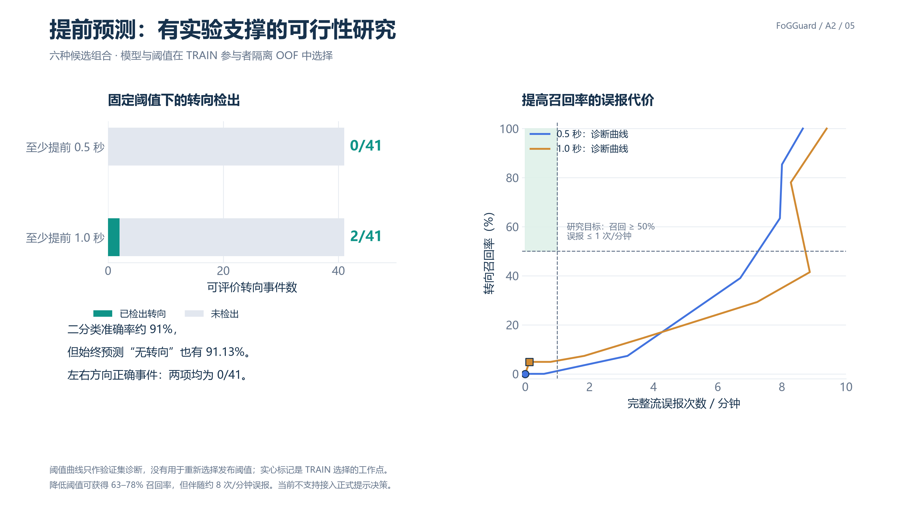

# A2 展示结果包

主线：**当前方向识别是主要成果；提前预测是有完整实验支撑的可行性研究。**

## 可直接引用的数据

| 指标 | 数值 | 评价范围 |
|---|---:|---|
| 当前方向主准确率 | **66.99%（757/1130）** | 真实方向明确；预测拒识仍计为错误 |
| 当前方向三类 macro-F1 | **71.97%** | 直走 / 左转 / 右转的 F1 等权平均 |
| 直走 / 左转 / 右转召回率 | **89.78% / 59.12% / 41.18%** | 同一主评价范围 |
| 预测覆盖率 | 76.46%（864/1130） | 明确方向中未拒识比例 |
| 未拒识样本准确率 | 87.62%（757/864） | 选择性准确率，不能替代主准确率 |
| 完整有效流四类准确率 / macro-F1 | 68.66% / 65.58% | 1921 个有效窗口，包含 791 个不确定真值 |

数据为 FoG-STAR 开发验证：14 人训练、4 人验证；TEST 未评分。窗口为 120 点、60 Hz，每 30 点更新。
模型为背部和左踝重力投影 12 维特征 + 300 棵树随机森林。当前方向候选使用开发验证选择，
以上不是独立盲测；存在跨人差异和较多右转拒识，不能据此宣称系统已完成四模块联调。
方向窗口真值要求某类活动占比至少 80%，且末样本仍为该类；其他活动或明显混合窗口保留不确定。

## 推荐展示顺序与图注

1. `01_overview.png`：方法与主结果，放在 A2 第一张结果页。
2. `02_confusion_main.png`：解释左右转与不确定输出，主范围一致。
3. `03_class_and_people.png`：逐类与逐人结果，说明右转和跨人稳定性的限制。
4. `04_real_timeline.png`：真实信号、样本级标签、窗口评价标签、模型输出的时间对齐。
5. `05_preturn_feasibility.png`：提前预测结论，建议放独立研究页或补充页。
6. `02b_confusion_full.png`：完整四类混淆矩阵，用于答辩补充。

所有图同时提供 PNG（3200×1800）和可缩放 SVG。PNG 适合直接插入 PPT；SVG 适合无损缩放。
`A2展示报告.html` 是包含图表的单文件离线报告；`data/` 内 CSV 是图表背后的汇总数据，可用 Excel 打开。
CSV 中准确率、P/R/F1 和覆盖率以 0–1 比例保存；计数、时间和误报率保留原单位，详见 data/README.md。
没有包含患者原始数据、逐窗文件或模型权重。

## 40 秒汇报稿

“A2 的主要成果是当前方向识别。我们使用背部和左踝 IMU，基于窗口内重力投影构造 12 维特征，
用随机森林识别直走、左转、右转和不确定。在四名参与者的开发验证数据上，明确方向窗口准确率为
66.99%，三类 macro-F1 为 71.97%，拒识也计为错误。直走识别较好，右转和跨人稳定性仍有提升空间。
我们另外完成了严格提前 0.5 秒及 1 秒的预测可行性研究，比较短时特征、双踝特征和两类模型。
在受限误报下转向召回仅为 0% 和 4.88%，因此目前保留为研究结论，不接入正式提示决策。”

## 提前预测的数据口径

| 任务 | 准确率 | 转向检出 | 完整流误报/分钟 |
|---|---:|---:|---:|
| 至少提前 0.5 秒 | 91.13% | 0/41 | 0.000 |
| 至少提前 1.0 秒 | 91.34% | 2/41（4.88%） | 0.131 |

始终预测“无转向”就有 91.13% 准确率。两项的左右方向正确事件均为 0/41。
模型及阈值在训练人员内部交叉验证选择；该四人验证集此前已被检查过，仍属于开发验证。
阈值诊断显示，提高召回会带来约 8 次/分钟误报，不支持将表面高准确率解释为有效预测。

## 图注

### 01_overview

在 1130 个方向明确的有效窗口上，重力投影随机森林准确率为 66.99%，三类 macro-F1 为 71.97%。拒识计为错误；这些是开发验证结果。

### 02_confusion_main

主评价混淆矩阵：行是真实方向，列为预测，格内为窗口数及行百分比。右转有 170/357 个窗口被拒识，是主要限制之一。

### 02b_confusion_full

补充评价包含 791 个不确定真值，共 1921 个有效窗口。四类准确率为 68.66%，四类 macro-F1 为 65.58%，与主三类评价范围不同。

### 03_class_and_people

直走、左转和右转召回率分别为 89.78%、59.12% 和 41.18%。四名验证参与者准确率差异明显，不能将窗口数等同于独立受试者数。

### 04_real_timeline

固定规则选取首条包含直走与转向的验证记录，未按成绩筛选。预测从输入窗口末点才可用，最多保持 0.5 秒；图中保留拒识、错误与边界滞后。

### 05_preturn_feasibility

提前预测作为可行性研究：训练内选定阈值后，0.5 秒与 1 秒模型仅检出 0/41 与 2/41 个转向事件；降低阈值提高召回伴随约 8 次/分钟误报。

## 来源与复现

FoG-STAR v3，DOI: https://doi.org/10.5281/zenodo.17838806，CC BY 4.0。
原始结果来自 A2 保存的方向评价、二分类评价和阈值诊断；具体输入、文件哈希及选例规则见 MANIFEST.json。
仓库内可用 `python -X utf8 scripts/build_a2_presentation.py --output reports/a2_presentation_NEW` 重新生成。
这是算法结果展示包，不包含 A1 感知融合、运动反馈或临床效果验证。
