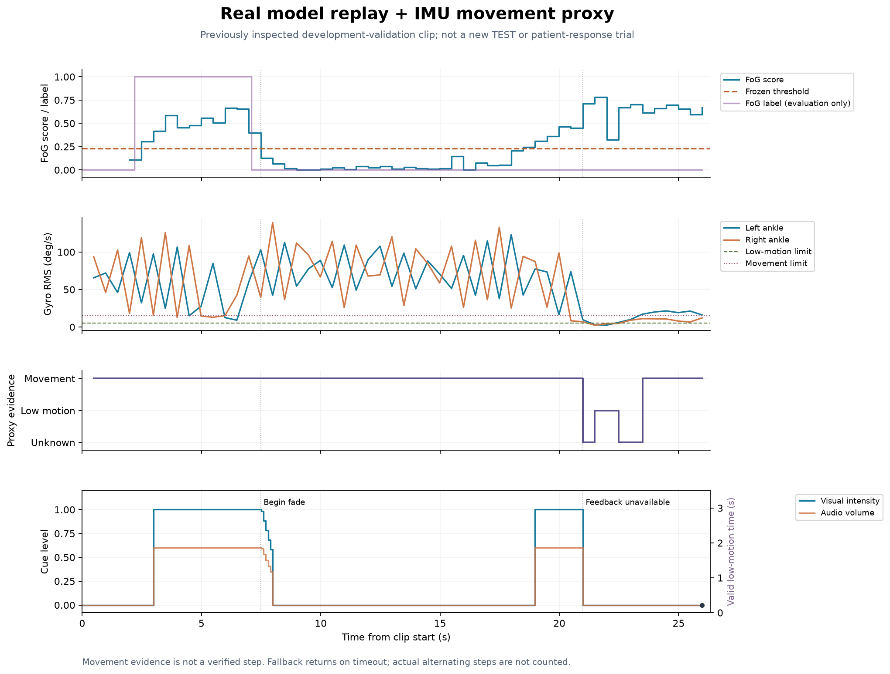
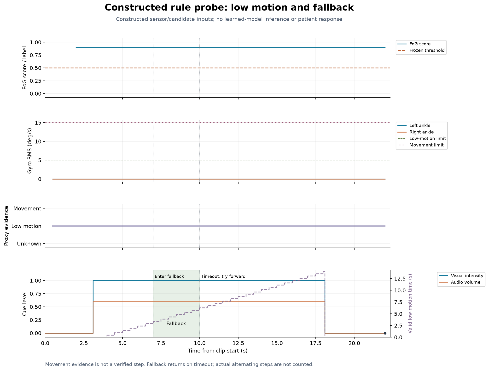
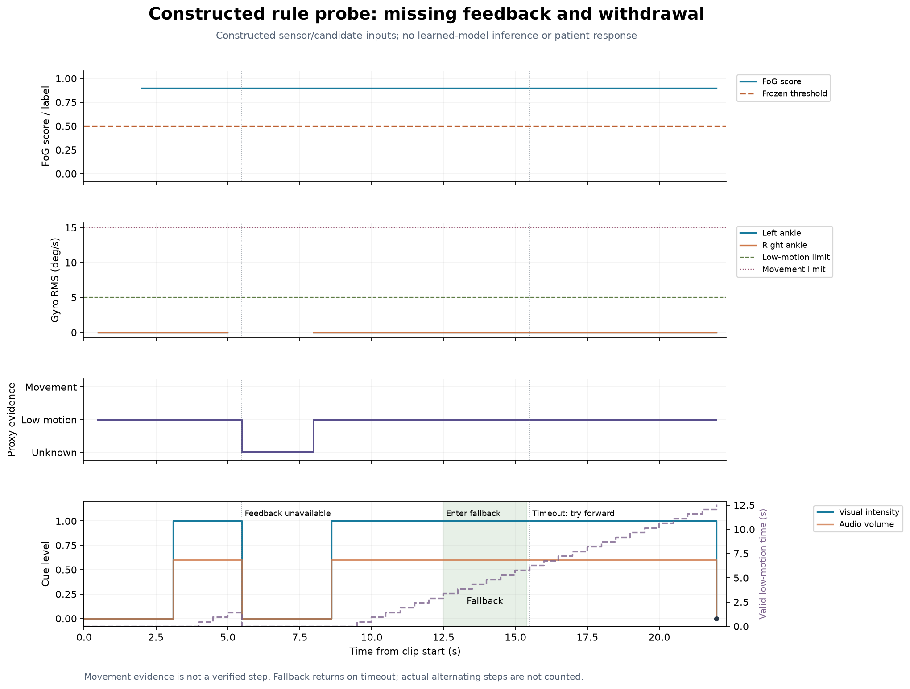

# B2 标准导出核对与过程证据

本页补齐两项交接工作：核对标准导出文件，以及展示真实回放、构造备用和异常撤销过程。没有重新训练模型，也没有更改原有模型、提示规则或既有实验结果。

## 先看结论

48 个输入案例、240 次策略运行、69,147 行命令已核对；170 对开始/停止命令全部闭合，1,056 次无响应计时增加均来自提示后新的有效低运动观察。标准本地包共 513 个受清单保护的文件，校验通过。

验收表共 20 项：16 项 PASS、1 项 NOT_IMPLEMENTED、1 项 NOT_EVALUABLE、2 项 NOT_RUN。这里的 PASS 是有明确范围的工程检查，**不表示 B1/B2 所有目标完成**。

- [标准文件逐案例清单](STANDARD_FILE_CHECKS.csv)：48 个案例各自是否有规定文件。
- [异常与功能验收矩阵](ACCEPTANCE_MATRIX.csv)：每项结果、证据和限制。
- [逐案例、逐策略检查结果](CASE_AUDIT.csv)：240 次运行的时长、计时与生命周期统计。
- [导出审计摘要](EXPORT_AUDIT.json)、[测试记录](TEST_CHECK.json)、[字段目录](FIELD_CATALOG.csv)。

## 标准包里有什么

完整包保存在实验电脑本地；它包含真实记录的派生时间线，不提交到 GitHub。GitHub 保存代码、核对表、匿名化过程图和转换摘要。程序可从原有保存实验重新生成标准包，不需要重新运行模型。

| 文件 | 已核对的内容 |
|---|---|
| perception_runtime.csv | 记录身份、决策时间、模型版本、来源新旧、质量与方向；保持原始字节 |
| feedback_runtime.csv | 运动代理状态、有效性、原因、观察窗口和可用时间；保持原始字节 |
| commands.csv | 选 march 为主回放，原文件直接复制；包含脚印、声音、强度、启停及切换原因 |
| comparisons/commands_*.csv | 其他四种方案；共用同一感知和反馈输入 |
| evaluation_truth.csv | 24 个真实案例单独复制原有评价标签；构造案例不伪造患者真值 |
| metrics.json | 工程检查、启动延迟定义、提示时长、状态切换、备用、退出，以及原有单独评价统计；无步真值的指标为 null |
| config.json / MANIFEST.json | 实际运动和控制配置、明确的超时返回规则、文件 SHA-256 |
| 根目录清单与来源 | EXPORT_INVENTORY.csv、FIELD_CATALOG.csv、CASE_AUDIT.csv、PROVENANCE.json、总 MANIFEST.json |

三个运行表使用同一记录身份和秒时钟，但采样频率不同，不能按行号拼接。反馈状态的实际实现名称是 movement_evidence / no_movement_evidence / unknown，均表示运动迹象，不是经验证的落脚。first_prompt_delay_s 从首次来源有效、冻结已确认且方向已知的感知时刻算起；无启动或无符合条件输入为 null，不是身体冻结起点或实测在线计算延迟。

## 过程一：真实模型与 IMU 回放



图中是一段已经查看过的开发验证数据。约 2.98 秒启动提示，7.48 秒开始渐弱，7.98 秒因感知不可用停止；18.98 秒再次启动，20.98 秒因反馈未知停止。[转换时间与原因](01_real_process_events.csv)可逐项核对。

模型后段分数升高时，评价标签已为非冻结，因此图中也保留了误提示的局限。上方真值只用于画图评价，不进入控制器。图没有证明患者响应了提示，也没有触发备用分支。

## 过程二：构造的持续低运动与备用



这是构造传感器和候选分数的工程案例，不是模型对患者的推理。3.10 秒启动提示；6.98 秒累计有效低运动约 3.38 秒后进入备用；10.00 秒备用超时返回尝试前进；18.10 秒达到单轮提示上限而停止。[转换记录](02_constructed_fallback_events.csv)。

实际时间包含完整观察窗口和决策时钟，因此不要求恰在启动后 3.00 秒切换。绿色区间为备用提示阶段；没有宣称观察到了四次交替迈步。

## 过程三：反馈缺失后的撤销与重新确认



这是构造的异常案例。5.48 秒反馈未知时撤销提示、计时清零；反馈恢复后继续等待新的冻结确认，8.60 秒重新启动。后续满足低运动条件再进入备用。结束时保存的终止命令关闭提示。[转换记录](03_feedback_gap_events.csv)。这是系统成功处理的异常输入，不是临床失败率。

## 尚未通过或不可评价

- **NOT_IMPLEMENTED**：根据可靠左右脚实际动作完成交替计数、错误脚别拒绝；当前按备用超时返回尝试前进，脚印交替是提示目标。
- **NOT_EVALUABLE**：没有独立步真值、位置真值和干预响应试验，不能报告迈步准确率、向前成功率或疗效。
- **NOT_RUN**：新电脑完整复现、第五位的最终画面/声音/字幕联合验收。
- 通用 OOF 原始数据审计仍为 NOT_RUN；与本次保存时间线核对是不同检查。

## 如何重新生成与检查

在仓库根目录、项目依赖可用的 Python 3.12 环境运行。使用新输出目录，保留旧证据；设置 PYTHONPATH 为仓库 src 的绝对路径，或先安装项目。

```text
python scripts/build_b2_handoff.py --run <updated-run> --plan <sample-plan> --output <new-private-bundle>
python scripts/build_b2_handoff.py --verify <new-private-bundle>
python -m pytest tests/test_b1_motion_proxy.py tests/test_b1_proxy_replay.py tests/test_b2_randomized_checks.py tests/test_b2_handoff_bundle.py -q --junitxml=<new-junit.xml>
python scripts/render_b2_handoff_evidence.py --bundle <new-private-bundle> --junit <new-junit.xml> --output <new-evidence-directory>
```

不带 --plan 可导出保存的运行表，但真实案例评价标签会明确标为未提供；本次完整包提供了对应采样计划并核对其哈希。绘图入口默认使用本次固定案例 clip_020，以及 low_motion_straight / feedback_gap_straight，不适用于任意缺少这些案例的实验。

最新全量 pytest 为 368 项通过；其中重点验收 36 项通过，Ruff 通过。完整交付脚本中的原有评估、演示与 560 次历史工程回归也通过；历史结果只作兼容性检查，不当成本次新模型结果。来源与测试范围见 JSON 记录。

第五位继续使用 [已有七条 UI 时间线](../03_UI/README.md)。本页新增的是核对证据，不是 PPT、讲稿或新 UI。
